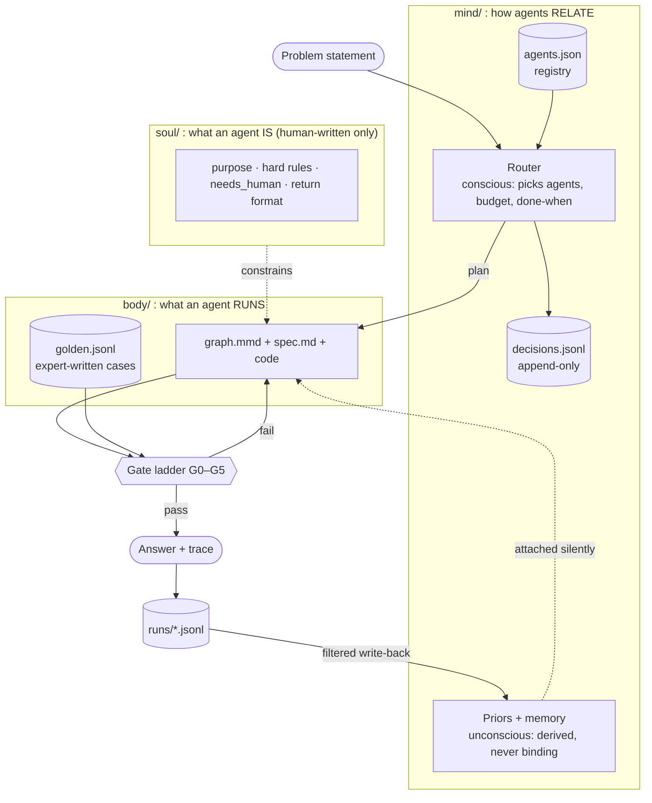
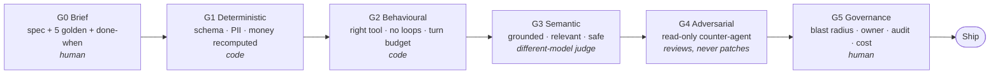
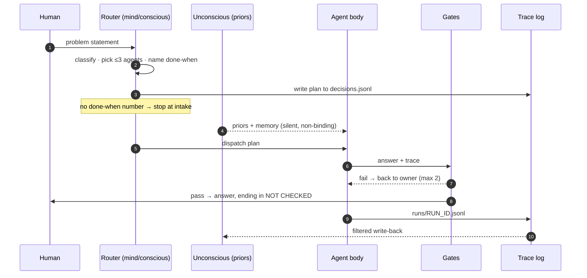
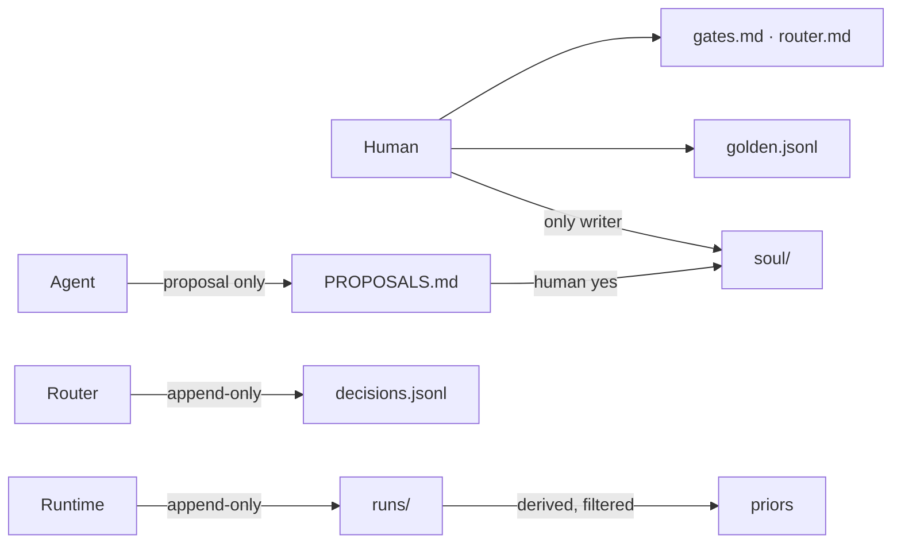

# Architecture

Agent Swarm is an **environment** for agents, not an agent. A problem goes in, the swarm decides which agent handles it, the agent runs, and a ladder of gates decides whether the result may be called done.

It has three layers, one gate ladder and one run lifecycle. This page shows all of them on one screen each. The rules behind them live in [`CONTRACT.md`](CONTRACT.md) and [`LAYERS.md`](LAYERS.md).

---

## 1. The big picture



**One-line test for where a fact belongs:** if it survives a rewrite of the agent, it's **soul**. If it survives deleting the agent, it's **mind**. Otherwise it's **body**.

---

## 2. The gate ladder

Every agent climbs the same six gates. Cheap, deterministic checks run first, so an expensive judge never scores an answer that already failed on arithmetic.



| Rule | Why |
|---|---|
| No golden cases → `DRAFT: no eval`, work stops | An agent with no test can't be judged |
| Judge is never the primary model | Self-review is theatre |
| Money is recomputed by a separate code path | Checking a sum with the code that produced it proves nothing |
| Review loops stop at 2 returns, then escalate | Prevents infinite fix-and-retry |
| Model choice happens **after** G0 | With golden cases, choosing a model is a measurement, not a debate |

---

## 3. The run lifecycle



**Write-back filter:** most traces stay as history. A new failure mode becomes a golden case. A repeated user fact becomes memory. A better method becomes a `PROPOSALS.md` entry, which needs a human yes.

---

## 4. Who may write what



**Precedence, highest first:** the human in session → [Constitution of Agents](https://github.com/mjha-arya/constitution-of-agents) → `CONTRACT.md` → soul → mind → body. A soul may tighten a Constitution article, never loosen it.

---

## 5. What's executable today

| Part | State |
|---|---|
| `tools/swarm.py gate <agent>` | **Runs G0 and G1.** Checks the brief, that the shipped artifact is built from the golden cases, and that the test and browser-proof commands pass. Exits non-zero on failure. |
| `swarm.py route` / `ledger` / `new` / `build` | Records routing decisions, appends scored runs, scaffolds new agents, and renders golden cases into the browser demo |
| G2–G4 in `swarm.py` | **Not automated yet.** The CLI prints `not run` and caps status at *authored*, never *verified* |
| Voice demo ([live](https://mjha-arya.github.io/agent-swarm/)) | Runs G1–G4-style checks per turn in the browser: invented slots, latency, policy and red-team probes |
| Inter-agent transport, autonomous scheduling, swarm-vs-single-agent eval | **Open questions.** See `CONTRACT.md` §7 and `STACK.md` |

```bash
python tools/swarm.py gate clinic-booking
python tools/swarm.py new my-agent
```

---

## NOT CHECKED
- Whether a swarm of agents beats a single agent on any task has not been measured.
- G2–G4 are specified in `mind/conscious/gates.md` but not yet wired into `swarm.py`.
